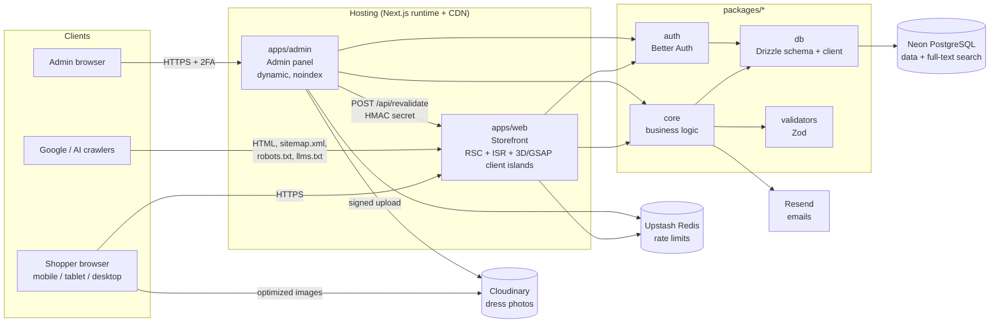
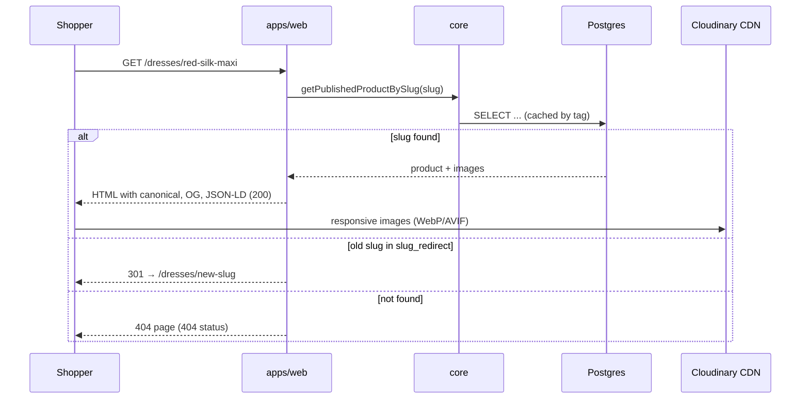

# System Architecture

## 1. Overview

Two Next.js apps in one monorepo share a database, auth and business logic.
The storefront is public and heavily cached; the admin panel is private and dynamic.
External free-tier services handle images, email and rate limiting.



## 2. Tech stack and why

| Layer | Choice | Why |
|---|---|---|
| Framework | **Next.js** (latest stable, App Router) | Server rendering = SEO; file-based multi-page routing; built-in metadata, sitemap, robots, OG image APIs; runs on most hosts |
| Language | TypeScript (strict) | Catches bugs before runtime; shared types across apps |
| Monorepo | **pnpm + Turborepo** | Admin and storefront are truly separate apps but share code; cached builds |
| Styling | **Tailwind CSS** + CSS variables | Fast responsive work; theme can be swapped later by changing tokens only |
| Motion | **GSAP** (+ ScrollTrigger, SplitText, Flip) via `@gsap/react` | Industry standard for premium motion; all plugins are free; `useGSAP` handles cleanup |
| Smooth scroll | **Lenis** | Smooth scrolling that works with ScrollTrigger |
| 3D | **Three.js + React Three Fiber + Drei** | Declarative 3D inside React; lazy-loaded so it never blocks content |
| Database | **PostgreSQL on Neon** | Relational data fits a catalogue; built-in full-text + fuzzy search (no extra search service); free tier; branching for test databases; works with any host |
| ORM | **Drizzle** | Type-safe SQL, lightweight, plain SQL migrations you can read |
| Auth | **Better Auth** | Email/password with scrypt hashing by default, sessions in DB, rate limiting, admin roles, 2FA plugins; framework-agnostic |
| Validation | **Zod** | One schema validates forms on client and server |
| Images | **Cloudinary** | Admin uploads straight to Cloudinary (signed); automatic resize + WebP/AVIF; global CDN; free tier |
| Email | **Resend** | Password reset, verification, inquiry notifications; free tier |
| Rate limits | **Upstash Redis** | HTTP-based, works on any serverless host; free tier |
| Tests | Vitest, RTL, Playwright, axe, Lighthouse CI | Fast unit tests + real-browser tests across devices |

**Database recommendation in short:** PostgreSQL (Neon) + Drizzle. Supabase is a fine alternative (Postgres + storage in one), but its free projects pause when idle, and Neon's branching makes isolated test databases easy.

## 3. Monorepo structure

```
.
├── apps/
│   ├── web/                      # storefront
│   │   ├── app/
│   │   │   ├── (shop)/           # public, indexable pages
│   │   │   │   ├── page.tsx                  # /
│   │   │   │   ├── shop/page.tsx             # /shop
│   │   │   │   ├── collections/[slug]/page.tsx
│   │   │   │   ├── dresses/[slug]/page.tsx
│   │   │   │   ├── about|contact|faq|privacy|terms/
│   │   │   ├── (noindex)/        # search, account, auth pages
│   │   │   │   ├── search/page.tsx
│   │   │   │   ├── account/...
│   │   │   │   └── login|register|forgot-password|reset-password/
│   │   │   ├── api/
│   │   │   │   ├── auth/[...all]/route.ts    # Better Auth
│   │   │   │   ├── search/suggest/route.ts
│   │   │   │   └── revalidate/route.ts       # called by admin
│   │   │   ├── sitemap.ts  robots.ts  llms.txt/route.ts
│   │   │   ├── opengraph-image.tsx  not-found.tsx  error.tsx
│   │   │   └── layout.tsx
│   │   ├── components/   (ui/, product/, motion/, three/, layout/)
│   │   ├── lib/          (seo.ts, site.ts, analytics.ts)
│   │   └── proxy.ts      # security headers / CSP nonce (called middleware.ts in older Next.js)
│   └── admin/
│       ├── app/(auth)/login, (panel)/dresses|categories|inquiries|customers|settings|audit
│       ├── app/api/auth/[...all], app/api/upload/sign
│       └── proxy.ts      # requires admin session on every route
├── packages/
│   ├── db/          schema/*.ts, client.ts, migrations/, seed.ts
│   ├── core/        products/, categories/, search/, inquiries/, wishlist/, settings/, audit/
│   ├── auth/        createAuth(options), requireUser(), requireAdmin()
│   ├── validators/  product.ts, inquiry.ts, auth.ts, search.ts ...
│   ├── ui/          primitives shared by both apps
│   └── config/      eslint, tsconfig, tailwind preset, prettier
├── e2e/             web/, admin/, seo/, a11y/, responsive/, security/
├── docs/
└── .claude/, .mcp.json, AGENTS.md, CLAUDE.md
```

**Layering rule:** `app/` (routes, UI) → `packages/core` (logic) → `packages/db` (data).
Pages and server actions stay thin: validate input, check auth, call `core`, return. Business rules live in `core` so they're unit-tested without a browser.

## 4. Rendering and caching

| Page | Strategy | Freshness |
|---|---|---|
| Home, collections, product, static pages | Server-rendered and cached (static/ISR, tagged) | Admin changes trigger on-demand revalidation by tag (`products`, `product:<id>`, `category:<slug>`, `settings`) |
| `/search` | Dynamic per request | Live |
| Account pages | Dynamic, per user, `no-store` | Live |
| sitemap.xml, llms.txt | Cached, revalidated with `products` tag | On change |
| Admin | Fully dynamic, `no-store` | Live |

**Cross-app revalidation:** the admin is a separate deployment, so it can't clear the storefront cache directly.
After each successful mutation it calls `POST {WEB_URL}/api/revalidate` with `{ tags: [...] }` and an HMAC signature using `REVALIDATE_SECRET`. The storefront verifies the signature and calls `revalidateTag`. Failures are logged and retried once; the cache also expires after 1 hour as a safety net.

**3D and motion never block content:** pages render full HTML on the server. 3D canvases and GSAP effects are client "islands" loaded after first paint (`next/dynamic`, `ssr: false`, `IntersectionObserver`), with a static poster image underneath. See `docs/design.md` §6–7.

## 5. Key request flows

### 5.1 Shopper opens a product page


### 5.2 Admin uploads a dress
1. Admin fills the form → client asks `POST /api/upload/sign` (admin session required) for a Cloudinary signature limited to the `products/` folder, image formats and 10 MB.
2. Browser uploads photos straight to Cloudinary (no large files pass through our server).
3. Admin submits the form → server action `createProduct` → `requireAdmin()` → Zod validation → verifies each Cloudinary `public_id` belongs to our account/folder → `core.products.create()` in a transaction → audit log entry.
4. Admin calls storefront `/api/revalidate` → new dress appears on the site and in the sitemap.

### 5.3 Shopper sends an inquiry
Product page → "Inquire" → form (Zod on client + server) → rate limit (5 per 10 min per IP) → honeypot check → `core.inquiries.create()` → Resend email to shop → success message showing the WhatsApp/phone options too.

### 5.4 Sign up / log in
Better Auth handles `/api/auth/*`: scrypt password hashing, DB sessions, httpOnly secure cookies, built-in rate limits, email verification and reset tokens. Details: `docs/auth-security.md`.

## 6. Search design

- Postgres generated `tsvector` column on products (name weight A, category/colour/fabric weight B, description weight C) with a GIN index.
- `pg_trgm` trigram index on product name for typo tolerance ("chifon" → "chiffon").
- Query: full-text rank first, trigram similarity as fallback; filters (category, size, colour, price) applied in SQL; paginated.
- Suggestions endpoint returns top 6 names + categories, debounced 250 ms on the client, rate-limited.
- No external search service needed at this size; switch to Meilisearch/Typesense only if the catalogue passes ~50k items.

## 7. Environments

| Env | Web URL | Database | Notes |
|---|---|---|---|
| Local | localhost:3000 / :3001 | Neon `dev` branch (or local Postgres) | `.env.local` |
| Test (CI) | built app on localhost | Throwaway Postgres container per CI run (PGlite for fast local integration tests) | External services mocked (`INTEGRATIONS_MODE=mock`) |
| Preview | host preview URL per push to `develop` | Neon `preview` branch | `noindex` header on all previews |
| Production | `SITE_URL` (free subdomain now, custom domain later) | Neon `main` branch | Only from `main` |

`SITE_URL` drives canonicals, sitemap, OG and llms.txt. Moving to a custom domain later = change `SITE_URL` + add a 301 from the old subdomain.

## 8. Hosting

The code is host-agnostic Next.js (no host-only storage, KV or image APIs). Options and the free-tier commercial-use caveat are in `docs/setup.md` → Hosting.

## 9. Observability

- Structured server logs (no passwords, tokens or full emails).
- Error boundary pages + server error logging; optional free error tracker (e.g. Sentry free tier) in Phase 8.
- Privacy-friendly analytics events: `inquiry_submitted`, `whatsapp_click`, `call_click`, `email_click`, `search`, `wishlist_add`.

## 10. Architecture Decision Records (ADRs)

Add a new row whenever a major decision changes.

| # | Decision | Status | Reason |
|---|---|---|---|
| 001 | Monorepo with separate `web` and `admin` apps | Accepted | Owner wants a separate admin; keeps admin code out of the public bundle; separate security rules |
| 002 | PostgreSQL (Neon) + Drizzle | Accepted | Relational catalogue, built-in search, free tier, branching for tests |
| 003 | Better Auth for accounts | Accepted | Secure defaults (scrypt, sessions, rate limits), roles + 2FA plugins, no vendor lock-in |
| 004 | Cloudinary signed direct uploads | Accepted | Automatic image optimization; large files never hit our server |
| 005 | Postgres full-text search, no external engine | Accepted | Enough for catalogue size; zero extra cost |
| 006 | Motion/3D as client islands after SSR | Accepted | Protects SEO, LCP and accessibility |
| 007 | Host-agnostic code | Accepted | Free-tier policies differ; keep the option to move |
| 008 | Contact-based ordering (no payments) in v1 | Accepted | Owner's scope decision; cart/payments are v2 |
