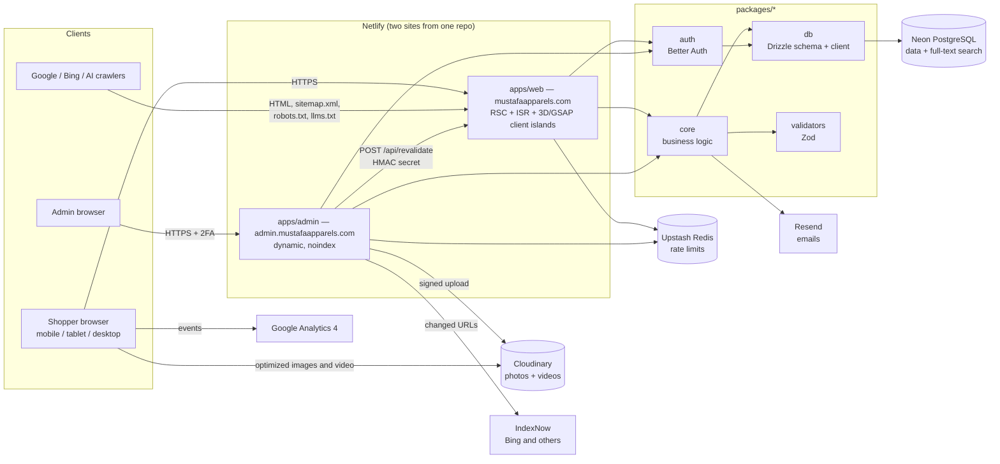
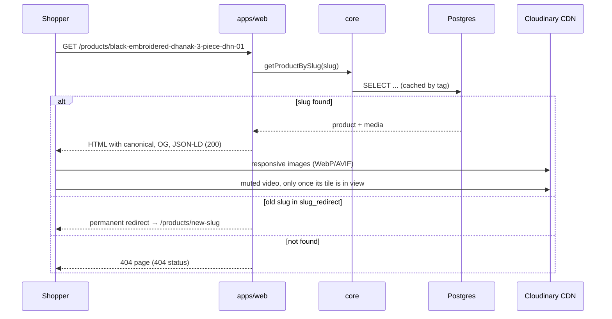

# System Architecture

## 1. Overview

Two Next.js apps in one monorepo share a database, auth and business logic.
The storefront is public and heavily cached; the admin panel is private and dynamic.
External free-tier services handle media, email, rate limiting and analytics. Both apps are hosted on Netlify's free plan, with DNS at Spaceship (`docs/deployment.md`).



## 2. Tech stack and why

| Layer | Choice | Why |
|---|---|---|
| Framework | **Next.js** (latest stable, App Router) | Server rendering = SEO; file-based multi-page routing; built-in metadata, sitemap, robots, OG image APIs |
| Language | TypeScript (strict) | Catches bugs before runtime; shared types across apps |
| Monorepo | **pnpm + Turborepo** | Admin and storefront are truly separate apps but share code; cached builds |
| Styling | **Tailwind CSS** + CSS variables | Fast responsive work; brand tokens live in one place |
| Motion | **GSAP** (+ ScrollTrigger, SplitText, Flip) via `@gsap/react` | Industry standard for premium motion; all plugins are free; `useGSAP` handles cleanup |
| Smooth scroll | **Lenis** | Smooth scrolling that works with ScrollTrigger |
| 3D | **Three.js + React Three Fiber + Drei** | Declarative 3D inside React; lazy-loaded so it never blocks content |
| Database | **PostgreSQL on Neon** | Relational data fits a catalogue; built-in full-text + fuzzy search (no extra search service); free tier; branching for test databases |
| ORM | **Drizzle** | Type-safe SQL, lightweight, plain SQL migrations you can read |
| Auth | **Better Auth** | Email/password with scrypt hashing by default, sessions in DB, rate limiting, admin roles, 2FA plugins; framework-agnostic |
| Validation | **Zod** | One schema validates forms on client and server |
| Media | **Cloudinary** | Admin uploads straight to Cloudinary (signed); automatic resize + WebP/AVIF; video posters and transcoding; global CDN; free tier. Media traffic never counts against Netlify credits |
| Email | **Resend** | Password reset, verification, inquiry notifications; free tier |
| Rate limits | **Upstash Redis** | HTTP-based, works on serverless; free tier |
| Analytics | **Google Analytics 4** | Owner's choice: free, plus conversion tracking and a Search Console link (`docs/analytics.md`) |
| Tests | Vitest, RTL, Playwright, axe, Lighthouse CI | Fast unit tests + real-browser tests across devices |

## 3. Monorepo structure

```
.
├── apps/
│   ├── web/                      # storefront
│   │   ├── app/
│   │   │   ├── (shop)/           # public, indexable, cached pages
│   │   │   │   ├── page.tsx                  # /
│   │   │   │   ├── shop/page.tsx             # /shop
│   │   │   │   ├── shop/page/[n]/page.tsx    # /shop/page/2 and up
│   │   │   │   ├── collections/[slug]/page.tsx
│   │   │   │   ├── collections/[slug]/page/[n]/page.tsx
│   │   │   │   ├── products/[slug]/page.tsx
│   │   │   │   ├── about|contact|how-to-order|faq|privacy|terms/
│   │   │   ├── (noindex)/        # search, account, auth pages (dynamic)
│   │   │   │   ├── search/page.tsx
│   │   │   │   ├── account/...
│   │   │   │   └── login|register|forgot-password|reset-password/
│   │   │   ├── api/
│   │   │   │   ├── auth/[...all]/route.ts    # Better Auth
│   │   │   │   ├── search/suggest/route.ts
│   │   │   │   ├── suits/route.ts            # cached list for browser filters
│   │   │   │   └── revalidate/route.ts       # called by admin
│   │   │   ├── sitemap.ts  robots.ts  llms.txt/route.ts
│   │   │   ├── opengraph-image.tsx  not-found.tsx  error.tsx
│   │   │   └── layout.tsx
│   │   ├── components/   (ui/, product/, motion/, three/, layout/)
│   │   ├── lib/          (seo.ts, site.ts, analytics.ts, cloudinary-loader.ts)
│   │   ├── public/brand/ # logo files, see docs/design.md §1.3
│   │   ├── netlify.toml  # build command, skip rule, netlify.app redirect
│   │   └── proxy.ts      # CSP nonce on dynamic routes only
│   └── admin/
│       ├── app/(auth)/login, (panel)/products|collections|inquiries|customers|settings|audit
│       ├── app/api/auth/[...all], app/api/upload/sign
│       ├── public/brand/
│       ├── netlify.toml
│       └── proxy.ts      # requires admin session on every route
├── packages/
│   ├── db/          schema/*.ts, client.ts, migrations/, seed.ts
│   ├── core/        products/, categories/, search/, inquiries/, wishlist/, settings/, audit/, integrations/
│   ├── auth/        createAuth(options), requireUser(), requireAdmin()
│   ├── validators/  product.ts, media.ts, banned-terms.ts, inquiry.ts, auth.ts, search.ts ...
│   ├── ui/          primitives shared by both apps
│   └── config/      @mustafa/config: eslint, tsconfig, tailwind preset, prettier
├── catalog/         one details file per suit, grouped by collection (docs/catalog.md)
├── scripts/         import-stock.ts (Phase 5), install-skills.sh
├── e2e/             web/, admin/, seo/, a11y/, responsive/, security/
├── mustafa-apparels-logos/   # official logo pack (source of public/brand files)
├── Business data/   # owner's raw stock, git-ignored, read-only
├── docs/
└── .claude/, .mcp.json, AGENTS.md, CLAUDE.md
```

**Tooling versions:** workspace packages use the `@mustafa/*` scope. Don't raise these without checking the peer ranges:
- **TypeScript stays on 6.0:** `typescript-eslint` 8 requires `<6.1.0`.
- **ESLint stays on 9:** `eslint-plugin-jsx-a11y` and `eslint-plugin-react` don't support 10 yet. ESLint 9 is already out of support upstream, so move to 10 as soon as both plugins allow it. It only runs in development and CI, not in the shop.
- **`next` is a dependency of `@mustafa/config`:** `eslint-config-next` loads its parser from `next` without declaring it. Keep this version the same as the apps'.
- **Install scripts stay off unless reviewed** (`allowBuilds` in `pnpm-workspace.yaml`). A new package with one fails the install until it's listed.

**Formatting:** Prettier skips all Markdown and `catalog/` (`.prettierignore`), so hand-written docs and suit files aren't rewritten.

**Layering rule:** `app/` (routes, UI) → `packages/core` (logic) → `packages/db` (data).
Pages and server actions stay thin: check auth, validate input, call `core`, return. Business rules live in `core` so they're unit-tested without a browser.

**Naming note:** customers see "collections", and the code keeps the `category` table and `categories` module. Customer URLs use `/collections/`.

## 4. Rendering and caching

| Page | Strategy | Freshness |
|---|---|---|
| Home, shop, collections, `/page/<n>`, product, static pages | Cached (static/ISR, tagged), **no per-request work** | Admin changes trigger on-demand revalidation by tag (`products`, `product:<id>`, `category:<slug>`, `settings`) |
| `/api/suits` | Cached, tagged `products` | Same |
| `/search` | Dynamic per request | Live |
| Account and auth pages | Dynamic, per user, `no-store` | Live |
| sitemap.xml, llms.txt | Cached, revalidated with `products` tag | On change |
| Admin | Fully dynamic, `no-store` | Live |

**Why caching is a hard rule:** on Netlify's free plan, compute costs 10 credits per GB-hour, and running out of credits takes both sites offline. A cached page costs almost nothing per visit. Don't make a public page dynamic, and don't apply nonces to it, without a new ADR.

**What keeps a page cached:** cached pages never read `searchParams`, `cookies()`, `headers()` or `connection()`.
- **Page numbers** come from the path (ADR-017).
- **Filters and sort** run in the browser (ADR-018). `useSearchParams` sits inside a `<Suspense>` boundary in a client component, so the page stays static.
- **Per-user UI**, such as the header's account state and wishlist hearts, loads client-side after paint, so cached HTML never holds user data.

**Cross-app revalidation:** the admin is a separate deployment, so it can't clear the storefront cache directly.
After each successful mutation it calls `POST {WEB_URL}/api/revalidate` with `{ tags: [...] }` and an HMAC signature using `REVALIDATE_SECRET`. The storefront verifies the signature and calls `revalidateTag`. Failures are logged and retried once; the cache also expires after 1 hour as a safety net. **Admin edits never trigger a deploy**, so they cost no deploy credits.

**3D, motion and video never block content:** pages render full HTML on the server. 3D canvases, GSAP effects and video players are client "islands" loaded after first paint (`next/dynamic`, `ssr: false`, `IntersectionObserver`), with a static poster image underneath. See `docs/design.md` §5–7.

## 5. Key request flows

### 5.1 Shopper opens a product page


### 5.2 Admin uploads a suit
1. Admin fills the form → client asks `POST /api/upload/sign` with `{ kind: 'image' | 'video' }` (admin session required) for a Cloudinary signature limited to the `products/` folder and the formats for that kind.
2. Browser uploads files straight to Cloudinary (no large files pass through our server). Size limits are enforced in the browser and re-checked on save.
3. Admin submits the form → server action `createProduct` → `requireAdmin()` → Zod validation → reads each asset's metadata from Cloudinary by `public_id` and rejects anything outside our folder, format list, size limit or video length limit → `core.products.create()` in a transaction → audit log entry.
4. Admin calls storefront `/api/revalidate` → new suit appears on the site and in the sitemap. On publish, changed URLs also go to IndexNow.

### 5.3 Shopper sends an inquiry
Product page → "Inquire" → form (Zod on client + server) → rate limit (5 per 10 min per IP) → honeypot check → `core.inquiries.create()` → Resend email to the shop → success message showing the WhatsApp/phone options too → GA4 `generate_lead`.

### 5.4 Sign up / log in
Better Auth handles `/api/auth/*`: scrypt password hashing, DB sessions, httpOnly secure cookies, built-in rate limits, email verification and reset tokens. Details: `docs/auth-security.md`.

### 5.5 Stock import
`Business data/Stock/<Collection>/` (collection file + photos + videos, read-only) → `catalog/<collection>/<design-id>.md` (one details file per suit, in git) → `scripts/import-stock.ts` validates the catalog, applies any crop in memory, uploads photos and videos to Cloudinary, and creates a **draft** product with no price → the owner clears any `check:`, sets the price in admin and publishes. `import_key` means re-running creates no duplicates. Media that shows another brand is listed as left out, and never uploaded. Details: `docs/catalog.md`.

## 6. Search design

- Postgres generated `tsvector` column on products (name weight A; fabric, colours, design and design code weight B; description weight C) with a GIN index.
- `pg_trgm` trigram index on product name for typo tolerance ("khadar" → "khaddar"). Product names include the fabric, so this covers spelling variants of fabric names.
- Query: exact design code match first, then full-text rank, with trigram similarity as fallback; filters (`docs/catalog.md` §4) applied in SQL; paginated.
- Lajwanti suits have fabric Dhanak, so a "dhanak" search finds them across collections.
- Suggestions endpoint returns top 6 names + collections, debounced 250 ms on the client, rate-limited.
- No external search service needed at this size; switch to Meilisearch/Typesense only if the catalogue passes ~50k items.

## 7. Environments

| Env | Web URL | Admin URL | Database | Notes |
|---|---|---|---|---|
| Local | localhost:3000 | localhost:3001 | Neon `dev` branch (or local Postgres) | `.env.local` |
| Test (CI) | built app on localhost | built app on localhost | Throwaway Postgres container per CI run (PGlite for fast local integration tests) | External services mocked (`INTEGRATIONS_MODE=mock`) |
| Preview | `develop--mustafa-apparels.netlify.app` | `develop--mustafa-apparels-admin.netlify.app` | Neon `preview` branch | Every push to `develop`. Costs no deploy credits. `noindex` on all responses, GA4 off |
| Production | https://mustafaapparels.com | https://admin.mustafaapparels.com | Neon `main` branch | Only from `main`. **15 credits per site per deploy** |

`SITE_URL` (`NEXT_PUBLIC_SITE_URL`) drives canonicals, sitemap, OG and llms.txt. Production stays `noindex` through `SITE_INDEXABLE=false` until launch, when the domain is connected (`docs/deployment.md` §6).

## 8. Hosting

Netlify free plan with two sites from one repo. Production deploys only when `develop` is merged to `main`, and each site skips its build when none of its files changed. Setup, credit budget, DNS and rollback: `docs/deployment.md`.

The code stays standard Next.js with no Netlify-only storage or APIs, so moving hosts later stays possible.

## 9. Observability

- Structured server logs (no passwords, tokens or full emails).
- Error boundary pages + server error logging; optional free error tracker (e.g. Sentry free tier) in Phase 9.
- GA4 events and conversions: `docs/analytics.md`.
- Credit and quota checks: Netlify (`docs/deployment.md` §3), Cloudinary (`docs/integrations.md`).

## 10. Architecture Decision Records (ADRs)

Add a new row whenever a major decision changes.

| # | Decision | Status | Reason |
|---|---|---|---|
| 001 | Monorepo with separate `web` and `admin` apps | Accepted | Owner wants a separate admin; keeps admin code out of the public bundle; separate security rules |
| 002 | PostgreSQL (Neon) + Drizzle | Accepted | Relational catalogue, built-in search, free tier, branching for tests |
| 003 | Better Auth for accounts | Accepted | Secure defaults (scrypt, sessions, rate limits), roles + 2FA plugins, no vendor lock-in |
| 004 | Cloudinary signed direct uploads | Accepted | Automatic optimization; large files never hit our server |
| 005 | Postgres full-text search, no external engine | Accepted | Enough for catalogue size; zero extra cost |
| 006 | Motion/3D as client islands after SSR | Accepted | Protects SEO, LCP and accessibility |
| 007 | Standard Next.js with no host-only APIs | Accepted | Keeps the option to move hosts if Netlify credits become a limit |
| 008 | Contact-based ordering (no payments) in v1 | Accepted | Owner's scope decision; orders happen on WhatsApp with courier delivery |
| 009 | Netlify free plan with two sites; DNS at Spaceship | Accepted | Owner's choice. Commercial use allowed on the free plan. Limit: 300 credits a month, and running out pauses both sites. See `docs/deployment.md` §3 |
| 010 | Two-tier CSP: fixed policy on cached public pages, nonces only on dynamic routes | Accepted | Nonces force dynamic rendering and disable ISR and CDN caching, which would cost credits and slow pages. **Trade-off:** public pages must allow inline scripts unless experimental SRI proves workable at step 3.9, so they rely on React escaping, Zod and no `dangerouslySetInnerHTML` except escaped JSON-LD |
| 011 | Videos on Cloudinary; `product_media` holds photos and videos | Accepted | Owner's stock includes video. Traffic goes to Cloudinary rather than Netlify bandwidth at 20 credits per GB. Video loads on product pages only, when in view |
| 012 | Google Analytics 4 | Accepted | Owner's choice, replacing the kit's cookieless plan. No cookie banner in v1; disclosed on the Privacy page. A practical default, not legal advice |
| 013 | `OnlineStore` search data; no Google Business Profile | Accepted | Online-only with no address. Google requires a location customers can visit, or travelling to customers |
| 014 | Leave `brand` out of Product JSON-LD; Mustafa Apparels is the `seller` | Accepted | The shop may not be the manufacturer, and it has no permission to name other brands |
| 015 | 3D hero uses a shader, with no downloaded model | Accepted | At 20 credits per GB, a 1.5 MB model costs about 30 credits per 1,000 home visits |
| 016 | Suit details live in `catalog/` as Markdown files, imported to the database as drafts | Accepted | `Business data/` stays out of git, so reviewable per-suit details need their own home. After import, admin owns prices and later edits |
| 017 | Path-based pages: `/collections/<slug>/page/<n>` and `/shop/page/<n>`, statically generated, each self-canonical. `/page/1` redirects to the clean URL, and out-of-range pages return 404 | Accepted | Owner's decision. Reading `?page=N` with `searchParams` would make the whole route dynamic, breaking the caching rule. New pages are generated on first request, then cached |
| 018 | Filters and sort run in the browser over one cached list (`/api/suits`) | Accepted | Owner's decision. Server-side filters would need `searchParams`, so every click would spend compute credits. `?fabric=` URLs still share and work with Back. **Trade-off:** crawlers see only the unfiltered pages, so filtered views can't rank, which the canonical rules already expect |
