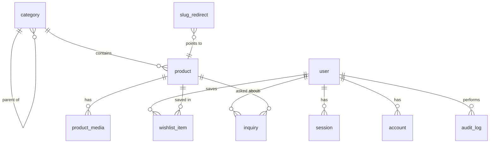

# Database

**PostgreSQL on Neon**, accessed only through **Drizzle ORM** in `packages/db`. Apps never write raw SQL in route files; queries live in `packages/core`.

## 1. Entity diagram



## 2. Tables

Conventions: `id` = `text` (cuid2/uuid v7), timestamps `timestamptz` default `now()`, snake_case columns, every FK indexed.

### Auth tables (owned by Better Auth — generate with its CLI, then extend)
| Table | Key columns |
|---|---|
| `user` | id, name, email (unique, lowercased), email_verified, image, **role** (`customer` \| `admin`, default `customer`), phone (nullable), banned, created_at, updated_at |
| `session` | id, user_id → user, token (unique), expires_at, ip_address, user_agent |
| `account` | id, user_id → user, provider_id (`credential`), **password** (scrypt hash — never plain text), created_at |
| `verification` | id, identifier, value, expires_at (email verification + password reset tokens) |
| `two_factor` | id, user_id, secret (encrypted), backup_codes (encrypted) — admins |

### Catalogue
**`category`** (shown to customers as "collections")
| Column | Type | Notes |
|---|---|---|
| id | text PK | |
| name | text not null | Dhanak, Khaddar, Lajwanti |
| slug | text unique not null | lowercase, kebab-case |
| description | text | |
| image_url / image_public_id | text | Cloudinary |
| parent_id | text → category | nullable, for sub-collections |
| sort_order | int default 0 | |
| is_active | bool default true | hidden when false |
| seo_title, seo_description | text | fall back to name/description |
| created_at, updated_at | timestamptz | |

**`product`**
| Column | Type | Notes |
|---|---|---|
| id | text PK | |
| name | text not null | Pattern: `Black Embroidered Dhanak 3-Piece Suit` |
| slug | text unique not null | e.g. `black-embroidered-dhanak-3-piece-d-18` |
| design_code | text, unique when set | Supplier code, e.g. `D-18`, `K-26A`. Shown to customers and included in WhatsApp messages |
| import_key | text, unique when set | Stable source file key, e.g. `dhnk1`. Set by the import script so re-runs change nothing; null for products created in admin |
| description | text | plain text / limited markdown, sanitized |
| price | integer **nullable**, check ≥ 0 | **whole PKR** (no floats for money). Null only on drafts |
| compare_at_price | integer nullable | shows "was" price; check > price |
| currency | char(3) default `'PKR'` | |
| category_id | text → category, not null | The collection |
| pieces | enum `two_piece` \| `three_piece`, not null | Filterable |
| piece_details | jsonb default `[]` | `[{ "piece": "shirt", "fabric": "Dhanak", "finish": "Embroidered" }, ...]`. Pieces: `shirt`, `dupatta`, `trouser` |
| fabric | text not null | Main fabric: `Dhanak`, `Khaddar`. Lajwanti suits are `Dhanak` |
| colors | text[] default `{}` | Filterable |
| work | text[] default `{}` | `embroidered`, `printed`, `plain_dyed`. Filterable |
| season | enum `winter` \| `summer` \| `all_season`, nullable | |
| care_instructions | text | |
| availability | enum `in_stock` \| `low_stock` \| `out_of_stock` | |
| status | enum `draft` \| `published` \| `archived` | only `published` is public |
| featured | bool default false | home page |
| attributes | jsonb default `{}` | future fields without migrations |
| seo_title, seo_description | text | |
| search_vector | tsvector **generated** | see §4 |
| published_at | timestamptz | set on first publish |
| created_at, updated_at | timestamptz | |
| deleted_at | timestamptz nullable | soft delete |

Check constraints on `product`:
- `status <> 'published' OR price IS NOT NULL`: a published suit always has a price.
- `compare_at_price IS NULL OR (price IS NOT NULL AND compare_at_price > price)`.

There is **no sizes column**. Suits are unstitched.

**`product_media`** (photos and videos)
| Column | Type | Notes |
|---|---|---|
| id | text PK | |
| product_id | text → product, cascade | |
| kind | enum `image` \| `video`, not null | |
| url | text not null | Cloudinary delivery URL |
| public_id | text unique not null | |
| alt | text not null | Required for photos and videos |
| width, height | int not null | |
| bytes | int not null | |
| format | text not null | |
| duration_seconds | numeric nullable | Required for videos, max 60 |
| poster_public_id | text nullable | Videos only; if null, the first frame is used |
| sort_order | int default 0 | |
| is_primary | bool default false | Main image |

Rules:
- Partial unique index: one `is_primary = true` per product.
- Check: `is_primary = false OR kind = 'image'`. The main item is always a photo, because it feeds LCP, the share image and JSON-LD.
- Check: `kind = 'image' OR (duration_seconds IS NOT NULL AND duration_seconds <= 60)`.
- Publishing (`core.products.setStatus`) requires a main image and refuses any product whose media or text fails §9.

**`slug_redirect`**: id, entity (`product` \| `category`), old_slug (unique per entity), target_id, created_at. Written automatically when a slug changes; used for 301s so canonicals never point at dead URLs.

### Engagement
**`inquiry`**: id, product_id → product (nullable for general questions), user_id → user (nullable for guests), name, email, phone, message (≤ 2000 chars), status enum `new` \| `contacted` \| `closed`, ip_hash (sha256 of IP + salt, for abuse checks — not the raw IP), created_at, updated_at.

**`wishlist_item`**: user_id → user (cascade), product_id → product (cascade), created_at. PK (user_id, product_id).

### Admin
**`site_setting`**: key text PK, value jsonb, updated_at, updated_by → user. Keys: `shop_name`, `phone`, `whatsapp`, `email`, `service_area`, `delivery_info`, `payment_info`, `return_policy`, `reply_note`, `socials`, `default_seo`.

There is no address or opening-hours setting. The shop is online-only with no fixed hours.

**`audit_log`**: id, actor_id → user, action (`product.create`, `product.update`, ...), entity, entity_id, changes jsonb (before/after, no secrets), created_at. Insert-only.

## 3. Indexes

| Index | Why |
|---|---|
| `product (status, category_id, published_at desc)` | collection pages |
| `product (status, featured)` | home page |
| `product (status, price)` | price sort/filter |
| `product (status, pieces)` | pieces filter |
| Partial unique `product (design_code)` where not null | design code lookup |
| Partial unique `product (import_key)` where not null | safe re-import |
| GIN `product.search_vector` | full-text search |
| GIN trigram `product.name gin_trgm_ops` | typo-tolerant search |
| GIN `product.colors`, `product.work` | filters |
| `product_media (product_id, sort_order)` | gallery |
| `inquiry (status, created_at desc)` | admin inbox |
| `slug_redirect (entity, old_slug)` unique | redirect lookups |

## 4. Search column (Drizzle)

Postgres only allows immutable expressions in a generated column, and `array_to_string` is not immutable. The first migration therefore creates a small wrapper:

```sql
create extension if not exists pg_trgm;

create function immutable_array_to_string(text[], text)
returns text language sql immutable parallel safe
as $$ select array_to_string($1, $2) $$;
```

```ts
// packages/db/schema/product.ts (excerpt)
searchVector: tsvector('search_vector').generatedAlwaysAs(
  (): SQL => sql`
    setweight(to_tsvector('simple', coalesce(${product.name}, '')), 'A') ||
    setweight(to_tsvector('simple', coalesce(${product.fabric}, '') || ' ' ||
              coalesce(${product.designCode}, '') || ' ' ||
              immutable_array_to_string(${product.colors}, ' ') || ' ' ||
              immutable_array_to_string(${product.work}, ' ')), 'B') ||
    setweight(to_tsvector('simple', coalesce(${product.description}, '')), 'C')`
),
```
- Use the `'simple'` text config (works for English and local fabric names like khaddar; no wrong stemming).
- Collection name is matched with a join, not stored in the vector (so renaming a collection needs no backfill).

Query shape (in `packages/core/search`):
```sql
select p.*, ts_rank(p.search_vector, q) as rank, similarity(p.name, $1) as sim,
       (lower(p.design_code) = lower($1)) as code_match
from product p, websearch_to_tsquery('simple', $1) q
where p.status = 'published' and p.deleted_at is null
  and (p.search_vector @@ q or p.name % $1 or lower(p.design_code) = lower($1))
order by code_match desc nulls last, rank desc, sim desc, p.published_at desc
limit $2 offset $3;
```
Always parameterized through Drizzle `sql` template — never string concatenation.

## 5. Migrations workflow

1. Edit schema in `packages/db/schema/*.ts`.
2. `pnpm db:generate` → review the SQL in `packages/db/migrations/` (commit it).
3. `pnpm db:migrate` against your dev branch; run `pnpm test`.
4. CI applies all migrations to a fresh Postgres container before integration and E2E tests.
5. Production migrations run in the storefront's production build (`docs/deployment.md` §2) **before** the new code goes live. Migrations must be backward compatible (add → backfill → switch → remove in a later release).

Rules: never edit an applied migration; never use `drizzle-kit push` on production; destructive changes need owner approval. Use the `db-change` skill.

## 6. Seed (`pnpm db:seed`)

- Categories: Dhanak (`dhanak`), Khaddar (`khaddar`), Lajwanti (`lajwanti`). The owner can rename or add more.
- Site settings: `shop_name` = Mustafa Apparels, `whatsapp` = `+923482799707`, `phone` = `+923069558717`, `service_area` = Pakistan, `email` = `ammarofficial321@gmail.com`.
- First admin from `SEED_ADMIN_EMAIL` + `SEED_ADMIN_PASSWORD` env vars (forced to set up 2FA on first login). Idempotent: running twice changes nothing.
- `--e2e` flag only: 12 demo suits with placeholder images, for tests. **Real stock comes through the import script** (Phase 5), never the seed.

## 7. Data rules

- Money is integer PKR. Format with `Intl.NumberFormat('en-PK', { style: 'currency', currency: 'PKR', maximumFractionDigits: 0 })`.
- A product without a price shows only in admin.
- Emails stored lowercase and trimmed.
- Phone and WhatsApp numbers stored in E.164 format (`+923482799707`).
- Soft delete products (`deleted_at`); hard delete only via an admin "purge" with confirmation.
- Deleting a user account cascades sessions, accounts and wishlist; inquiries are kept but anonymized (name → "Deleted user", email/phone cleared).
- Backups: Neon point-in-time restore on the free plan covers a short window; also run a weekly `pg_dump` (GitHub Action to a private artifact) once real data exists.

## 8. Connection

- `packages/db/client.ts` exports one Drizzle client using Neon's serverless driver (HTTP for single queries, WebSocket pool for transactions).
- Use the **pooled** connection string in apps; the direct string only for migrations.
- Tests: unit tests mock nothing in `core` that touches SQL — they run against PGlite (in-memory Postgres) or a Neon test branch. See `docs/testing-qa.md`.

## 9. Banned brand names

`packages/validators/src/banned-terms.ts` holds the names of brands the shop has no permission to use: Elaf, Baroque, Maria B (also `Maria.B`, `MariaB`) and HS Fashion. The check ignores case and punctuation.

It runs on every customer-facing text field: product name, slug, description, care instructions, media alt text, SEO fields and collection text. Add a name here when new stock arrives showing another brand. The owner can remove a name only with written permission from that brand.
